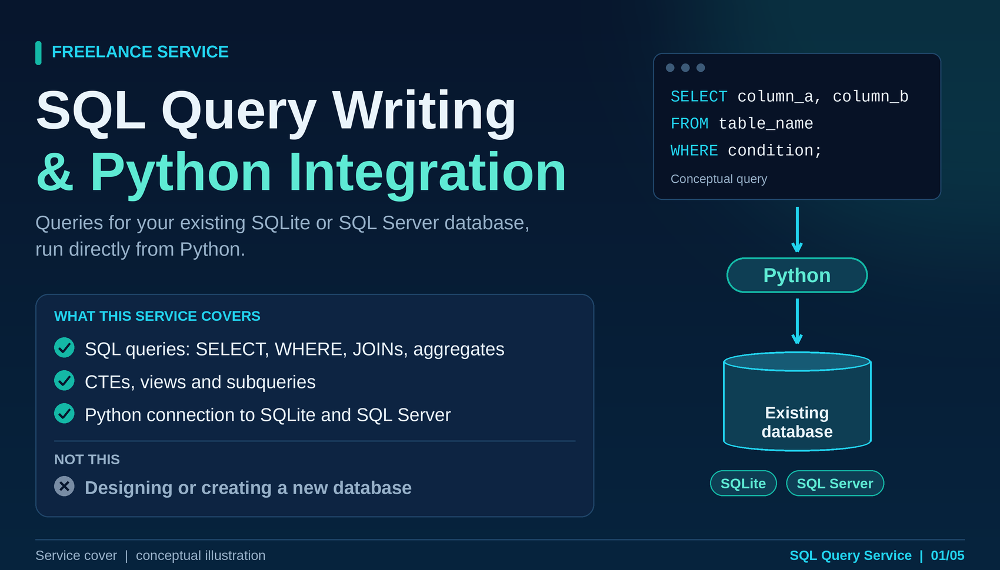
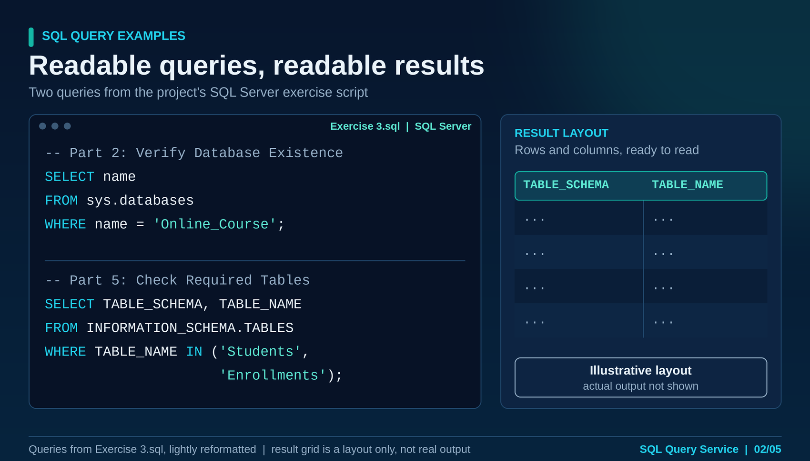
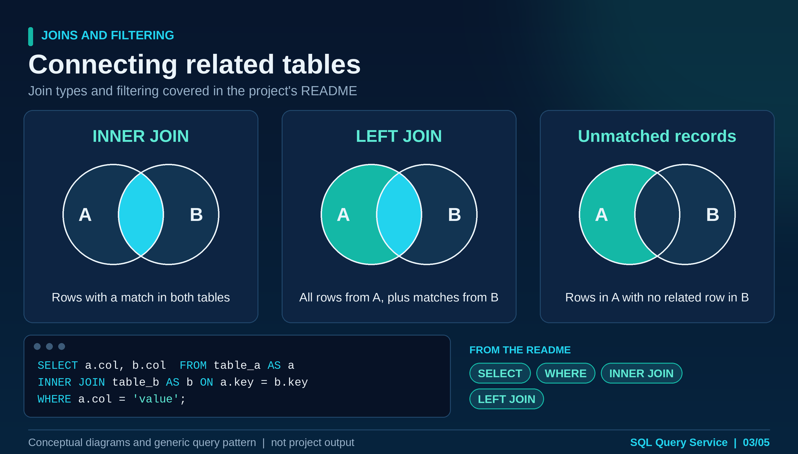
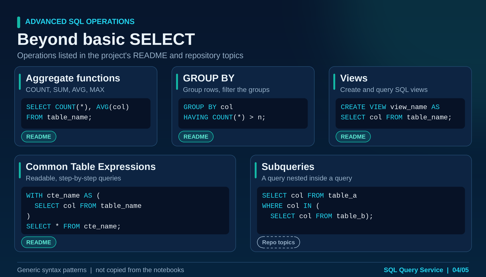
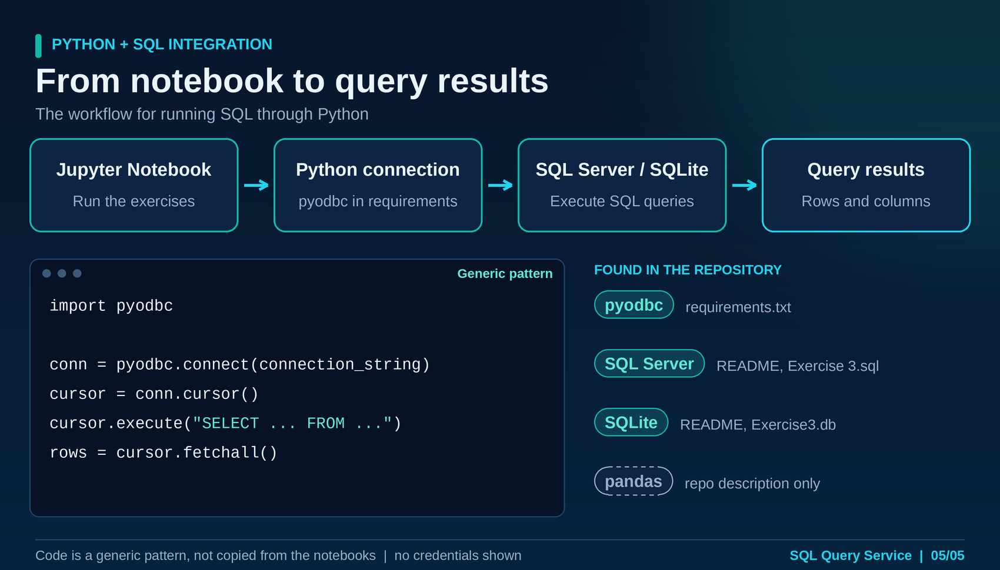

# Python & SQL Database Practice

A hands-on practice repository exploring SQL query writing, relational database concepts, and Python database connectivity. It includes SQL scripts, SQLite data, Jupyter notebooks, and visual references for common database workflows.


## Overview

This repository documents practical exercises using SQL and Python, including retrieving and filtering records, joining tables, aggregating data, and executing SQL through Python. The exercises use SQLite and include SQL Server-related practice where configured.

The repository is a learning portfolio: examples and diagrams are intended to illustrate the topics practiced, while the notebooks and SQL scripts remain the source of truth for the actual exercises.

## Visual Gallery

### SQL Query Writing Service

These five images provide a focused overview of SQL query writing and Python integration.

#### 1. SQL Query Service Cover



#### 2. SQL Query Examples



#### 3. SQL Joins and Filtering



#### 4. Advanced SQL Operations



#### 5. Python and SQL Integration



### Additional Project Visuals

The following images were already part of the repository and are retained here.

#### 6. Database Code Preview


#### 7. Python and SQLite Workflow


#### 8. SQL Operations Overview


## Topics Practiced

Depending on the exercise, the repository covers:

- Retrieving and filtering records with `SELECT` and `WHERE`.
- Combining related records using SQL joins.
- Using aggregate functions such as `COUNT`, `SUM`, `AVG`, and `MAX`.
- Grouping results and applying conditions to aggregated data.
- Practicing additional SQL constructs, including views or CTEs where demonstrated in the relevant exercise.
- Connecting Python to a database and executing SQL queries.
- Reviewing query results and presenting structured data.

Refer to each notebook or SQL script for the specific operations and setup required.

## Technologies and Tools

- **Python**
- **SQL**
- **SQLite**
- **SQL Server** (for the relevant exercises, with a configured instance and driver)
- **pyodbc** (where used for SQL Server connectivity)
- **Jupyter Notebook**
- **Git and GitHub**

## Repository Structure

```text
python-sql-database-practice/
├── images/
│   ├── 01-sql-query-service-cover.png
│   ├── 02-sql-query-examples.png
│   ├── 03-sql-joins-and-filtering.png
│   ├── 04-advanced-sql-operations.png
│   ├── 05-python-sql-integration.png
│   ├── database-code-preview.png
│   ├── project-banner.png
│   ├── python-sqlite-workflow.png
│   └── sql-operations-overview.png
├── Exercise 3.sql
├── Exercise3.db
├── SQL_Python_EX sol.ipynb
├── python_sql_my_solution.ipynb
├── requirements.txt
├── .gitignore
└── README.md
```

## Project Files

| File | Purpose |
|---|---|
| `Exercise 3.sql` | SQL practice queries and database exercises. |
| `Exercise3.db` | SQLite database file associated with the exercises. |
| `SQL_Python_EX sol.ipynb` | Notebook for SQL exercises involving Python/database workflows. |
| `python_sql_my_solution.ipynb` | Additional notebook with SQL practice and solutions. |
| `requirements.txt` | Python dependencies listed for the project. |
| `images/` | Project banner, query-service visuals, code preview, and workflow diagrams. |

## Getting Started

### 1. Clone the Repository

```bash
git clone https://github.com/youmna24zaian/python-sql-database-practice.git
cd python-sql-database-practice
```

### 2. Set Up Python

Create and activate a virtual environment if desired:

```bash
python -m venv .venv
```

On Windows:

```bash
.venv\\Scripts\\activate
```

Install the listed dependencies:

```bash
pip install -r requirements.txt
```

Some exercises may use Python's built-in `sqlite3` module and require no additional database package. SQL Server exercises may require a configured SQL Server instance and an appropriate ODBC driver.

### 3. Open the Exercises

Open the notebooks in Jupyter Notebook, JupyterLab, or Visual Studio Code. Review each notebook or SQL script before running it, and configure any required database connection settings for your environment.

**Note:** Requirements and connection settings can differ between exercises. The repository is for practice and learning; successful execution depends on the local database setup.

## Learning Goals

- Build confidence writing and reading SQL queries.
- Practice working with related tables and query results.
- Understand how Python can connect to a database and execute SQL.
- Keep exercises and learning notes organized in a version-controlled repository.

## Author

**Youmna Zaian**  
Computer Engineering Graduate | AI & Machine Learning | Python & Data Science

*This repository documents practical exercises and ongoing development of SQL and Python database skills.*
