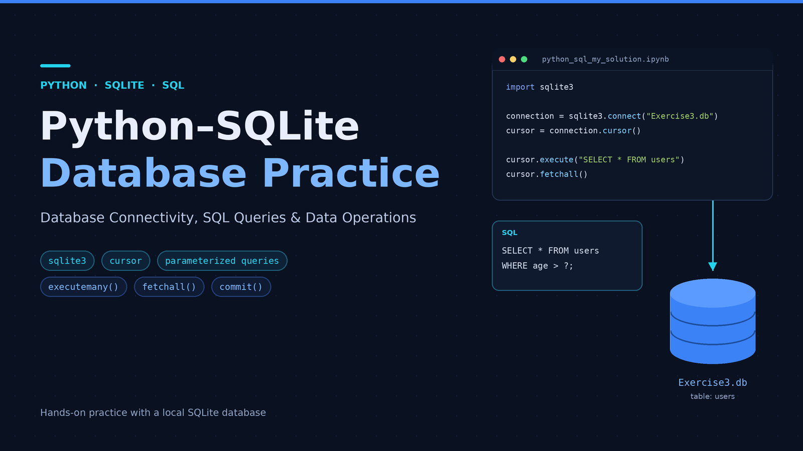
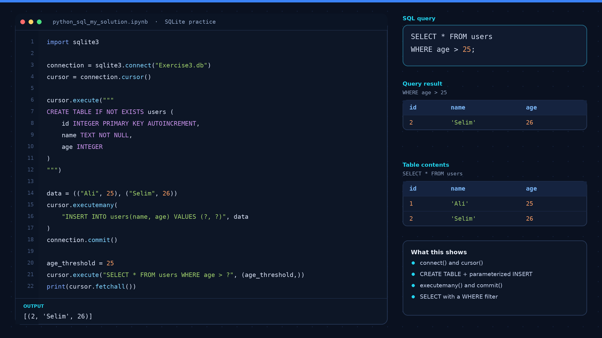
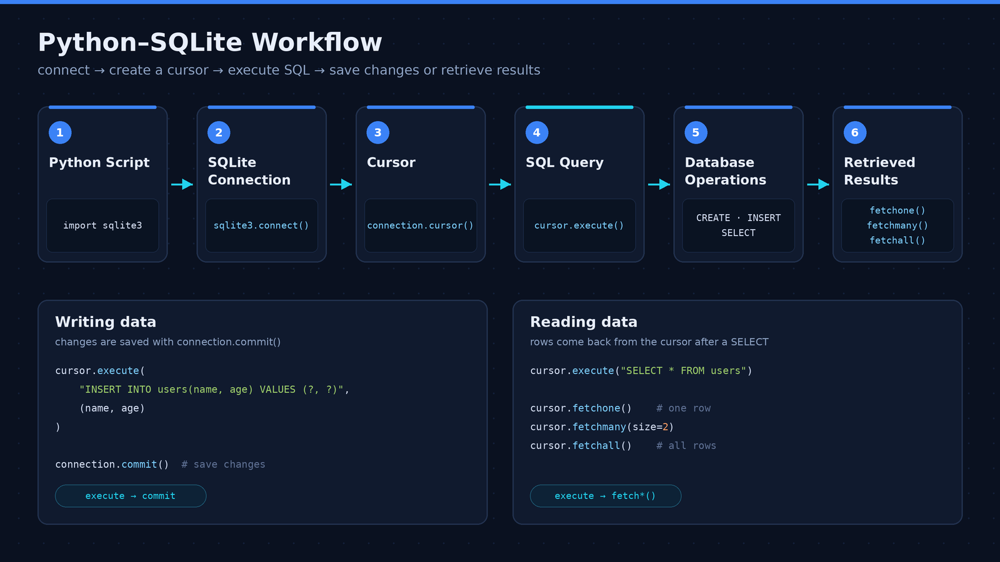
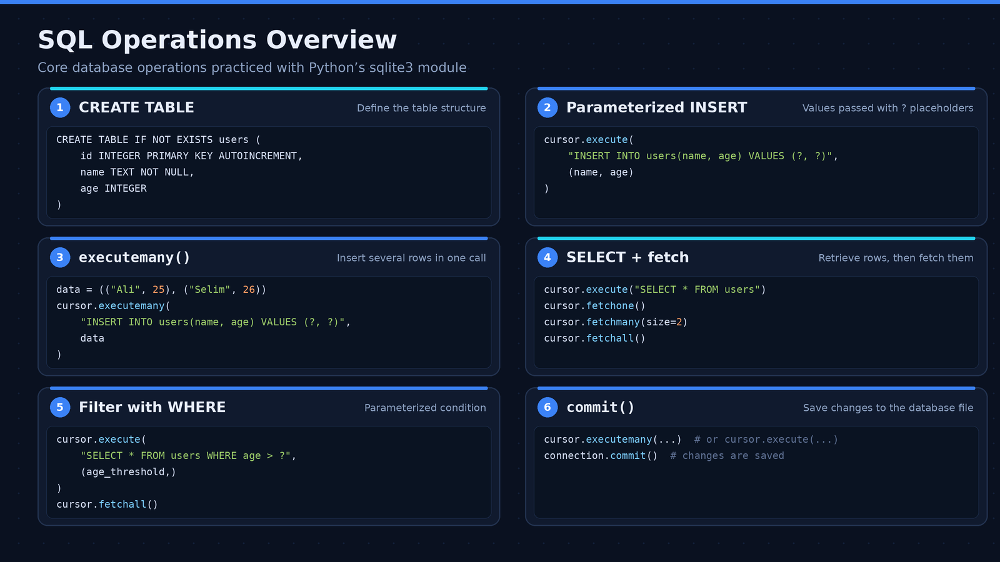

# Python & SQL Database Practice

A hands-on learning project focused on SQL queries, relational database concepts, and connecting Python applications to databases. This repository includes SQL scripts, Jupyter Notebooks, database exercises, and visual documentation.



## Project Overview

This project demonstrates practical database exercises using SQL and Python. It covers querying and filtering data, joining tables, aggregating results, working with database objects, and connecting Python to SQLite and SQL Server.

The repository is intended to document my learning journey and practical exercises in database management and Python database connectivity.

## Project Visuals

### Project Cover


### 1. Database Code Preview

A visual overview of database-related code and SQL operations used in the practice project.



### 2. Python and SQLite Workflow

A visual representation of the workflow for connecting Python to an SQLite database and working with stored data.



### 3. SQL Operations Overview

An overview of SQL operations and relational database concepts covered in the exercises.



### 4. Data Visualization — Bar Chart

A bar chart example illustrating how data can be presented and compared visually.


### 5. Dashboard

A dashboard-style visual demonstrating how key information and metrics can be organized for easier interpretation.


### 6. Table Results

A table-based view illustrating structured data and query results.


### 7. Orders Chart

A chart focused on order-related data, demonstrating another way to present and interpret information visually.


## Technologies & Tools

- **Python**
- **SQL**
- **SQLite**
- **SQL Server**
- **pyodbc**
- **Jupyter Notebook**
- **Git and GitHub**

## Repository Structure

```text
python-sql-database-practice/
│
├── images/
│   ├── project-banner.png
│   ├── cover.png
│   ├── database-code-preview.png
│   ├── python-sqlite-workflow.png
│   ├── sql-operations-overview.png
│   ├── gallery-one-bar-chart.png
│   ├── gallery-two-dashboard.png
│   ├── gallery-three-table-result.png
│   └── gallery-four-orders-chart.png
│
├── Exercise 3.sql
├── Exercise3.db
├── SQL_Python_EX sol.ipynb
├── python_sql_my_solution.ipynb
├── requirements.txt
├── .gitignore
└── README.md
```

## Concepts Practiced

- Retrieving and filtering records using `SELECT` and `WHERE`.
- Combining data from multiple tables using `INNER JOIN` and `LEFT JOIN`.
- Identifying records without matching related records.
- Using aggregate functions such as `COUNT`, `SUM`, `AVG`, and `MAX`.
- Grouping records and filtering aggregated results.
- Creating and querying SQL views.
- Working with Common Table Expressions (CTEs).
- Connecting Python to databases and executing SQL queries.
- Organizing project files and documenting work with GitHub.
- Presenting data through charts, tables, and dashboard-style visuals.

## Project Files

| File | Description |
|---|---|
| `Exercise 3.sql` | SQL exercises for practicing queries and database operations. |
| `Exercise3.db` | SQLite database file associated with the exercises. |
| `SQL_Python_EX sol.ipynb` | Notebook containing SQL practice through Python database connectivity. |
| `python_sql_my_solution.ipynb` | Notebook containing additional SQL practice and solutions. |
| `requirements.txt` | Python package dependencies for the project. |
| `images/` | Project banner, cover, workflow diagrams, code previews, and data visualization images. |

## Getting Started

### 1. Clone the Repository

```bash
git clone https://github.com/youmna24zaian/python-sql-database-practice.git
cd python-sql-database-practice
```

### 2. Set Up the Python Environment

Create a virtual environment:

```bash
python -m venv .venv
```

Activate it on Windows:

```bash
.venv\Scripts\activate
```

Install the required packages:

```bash
pip install -r requirements.txt
```

### 3. Configure the Database

Make sure the database engine and driver required by your selected exercise are installed and configured.

For SQL Server exercises, update the connection settings to match your SQL Server instance.

For SQLite exercises, use the relevant database file and connection code.

### 4. Run the Notebooks

Open the Jupyter Notebooks using Jupyter Notebook, JupyterLab, or Visual Studio Code. Execute the cells in order and verify that the required database connection is configured correctly.

**Note:** Database setup requirements may differ between exercises. Review the relevant notebook or SQL script before execution.

## Learning Objectives

- Strengthen SQL query-writing skills through practical exercises.
- Understand relational database concepts and table relationships.
- Practice joins, aggregations, views, and CTEs.
- Explore database connectivity using Python.
- Improve project documentation and version-control practices.
- Understand how charts, tables, and dashboards can help communicate data.

## Author

**Youmna Zaian**

Computer Engineering Graduate | AI & Machine Learning | Python & Data Science

*This repository is a learning project documenting practical exercises and continued development of database and Python skills.*
